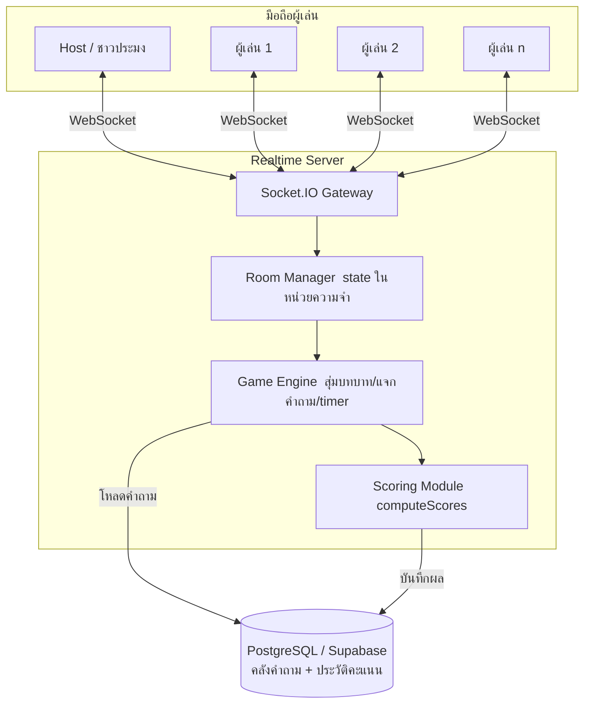
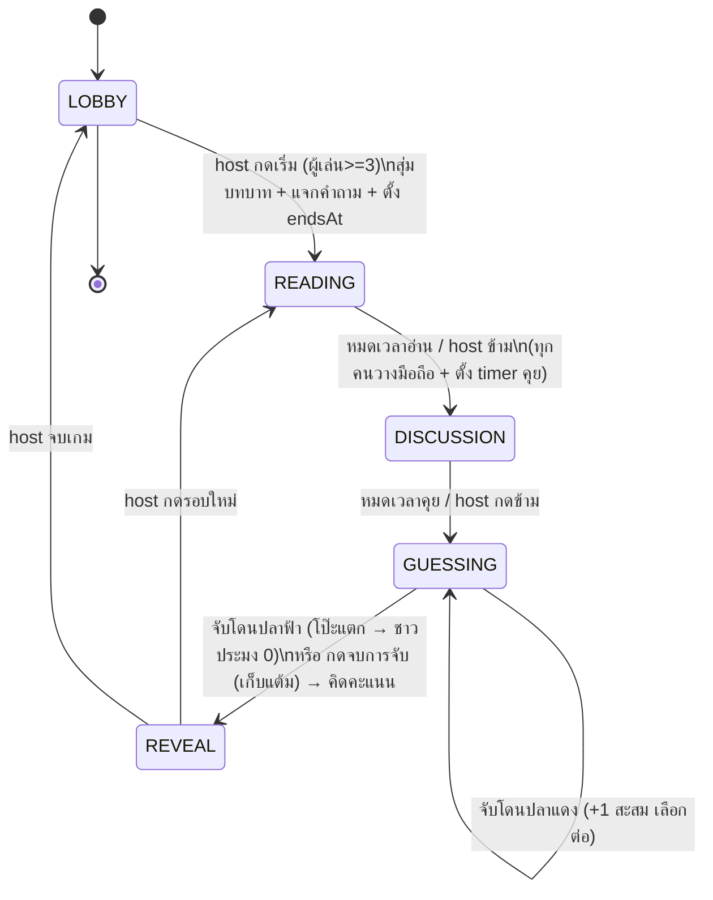

# สถาปัตยกรรมและแผนพัฒนา — เว็บเกมแนว Bluff (Face-to-Face)

> เอกสารนี้ต่อยอดจาก `แนวคิดเว็บเกม_Bluff_Face_to_Face.md`
> เป้าหมาย: วางสถาปัตยกรรม, data model, สัญญาการสื่อสาร (event contract), และแผนพัฒนาเป็นขั้น ๆ ก่อนลงมือเขียนโค้ด

---

## 1. สรุปโจทย์และข้อจำกัดที่มีผลต่อสถาปัตยกรรม

| ประเด็น | ผลต่อการออกแบบ |
|---|---|
| เล่นต่อหน้ากัน มือถือเป็นตัวช่วย | ไม่ต้องมี voice/chat ในเว็บ — realtime แค่ sync สถานะห้อง/รอบ/timer/เฉลย |
| **มีข้อมูลลับต่อผู้เล่น** (บทบาท + คำตอบจริงที่เห็นเฉพาะปลาฟ้า) | **ต้องมี server ที่ authoritative** ส่ง payload เฉพาะรายคน ห้าม broadcast ข้อมูลลับ |
| จำนวนคนต่อห้องน้อย (ส่วนใหญ่ 3–10 คน) แต่ห้องเยอะ | ไม่ต้องรีดประสิทธิภาพต่อห้อง แต่ต้องรองรับหลายห้องพร้อมกัน |
| มือถือล็อกจอ/สลับแอปได้ระหว่างเล่น | **ต้องรองรับ reconnect** และเก็บ slot ผู้เล่นไว้ชั่วคราว |
| Host เป็นคนคุมจังหวะ (เริ่ม/ข้าม/เฉลย) | Server ต้อง authorize คำสั่ง host ด้วย token ไม่ใช่เชื่อ client |
| Timer ต้องตรงกันทุกเครื่อง | Server เป็นเจ้าของเวลา ส่ง `endsAt` (absolute timestamp) ให้ client นับถอยหลังเอง |

### จำนวนผู้เล่นขั้นต่ำ
1 ชาวประมง + 1 ปลาฟ้า + ปลาแดง ≥1 = **ขั้นต่ำ 3 คน** (บังคับตรวจก่อนเริ่มเกม)

---

## 2. ✅ กติกาที่เคาะแล้ว (resolved)

จุดที่เอกสารต้นทางเคยขัดกัน ตอนนี้เคลียร์แล้ว — กลายเป็นชุดกติกาที่สอดคล้องกัน:

### ช่วงทาย = ไล่จับแบบ push-your-luck
1. ชาวประมงเลือกผู้เล่นทีละคน ระบบเฉลยทันทีว่า **ปลาแดง** หรือ **ปลาฟ้า**
2. จับโดน **ปลาแดง** → ถูกจับ, ชาวประมงสะสม **+1** (ยังไม่ปลอดภัย), เลือกต่อได้
3. จับโดน **ปลาฟ้า → "โป๊ะแตก"** → ชาวประมงคะแนน**รอบนั้นเหลือ 0**, ปลา**ทุกตัว** (แดง+ฟ้า) ได้ **+1**, จบรอบ
4. ชาวประมง **กด "จบการจับ" ได้ทุกเมื่อ** → เก็บแต้มที่สะสมไว้, ปลาที่ยังไม่ถูกจับ +1 (เปิด/ปิดปุ่มได้ในตั้งค่า)

### ระบบคะแนน (push-your-luck)
ให้ **A = จำนวนปลาที่รอด** (ปลาที่ยังไม่ถูกจับ ณ ตอนจบรอบ — นับปลาฟ้าที่รอดด้วย)

- **ปลาที่รอด:** ได้คนละ **A แต้ม** (รอดพร้อมกัน 4 ตัว → คนละ 4) — ยิ่งรอดพร้อมกันเยอะยิ่งได้เยอะ
- **ปลาแดงที่ถูกจับ:** **0 เสมอ** (ทั้งกรณีจบเองและโป๊ะแตก — ถูกจับแล้วไม่คืนแต้ม)
- **ชาวประมง:**
  - **กดจบการจับเอง (bank):** เก็บ **+1 ต่อปลาแดงที่จับได้**
  - **จับโดนปลาฟ้า (bust):** **0 ทั้งรอบ** (เสียแต้มที่สะสมมาทั้งหมด)
- คะแนนสะสมข้ามรอบเก็บต่อเนื่อง (โชว์ในหน้าประวัติ)

> **จุดสำคัญ:** ผลของ *ฝั่งปลา* เหมือนกันไม่ว่าชาวประมงจะกดจบเองหรือโป๊ะแตก (ปลาที่รอดได้ A เท่ากัน, ปลาแดงที่ถูกจับได้ 0 เท่ากัน)
> ต่างกันแค่ **ชาวประมง**: จบเองได้แต้มที่สะสม / โป๊ะแตกเหลือ 0
>
> จุดสมดุล: ยิ่งจับปลาแดงเยอะ ชาวประมงยิ่งได้แต้ม แต่ทุกครั้งเสี่ยงโดนปลาฟ้าแล้วเสียทั้งรอบ → ชั่งใจว่าจะเก็บต่อหรือกดจบล็อกแต้ม

**ตัวอย่าง** (4 ปลา: 3 แดง + 1 ฟ้า): ชาวประมงจับ 2 แดงแล้วโดนปลาฟ้า → ปลารอด 2 ตัว (แดง 1 + ฟ้า) ได้คนละ **+2**, แดงที่ถูกจับ 2 ตัว = 0, ชาวประมง = 0
(ถ้าชาวประมงกดจบตอนได้ 2 แทน → ปลารอดได้คนละ 2 เท่าเดิม แต่ชาวประมงเก็บ +2)

### ข้อมูลลับที่แต่ละบทบาทเห็น
- **ปลาฟ้า:** คำถาม **+ คำตอบจริง**
- **ปลาแดง:** คำถามอย่างเดียว (ไม่เห็นคำตอบจริง — ต้องแต่งเอง)
- **ชาวประมง:** คำถามอย่างเดียว — *หรือ* **ไม่เห็นคำถามเลย** ถ้าโฮสต์เปิดโหมด "ซ่อนคำถามจากชาวประมง" ในตั้งค่า (server ส่ง `prompt: null` ให้ชาวประมง — ซ่อนจริงระดับ payload)

> คำถามควรเป็นความรู้ที่เดายาก (คลังเริ่มต้นใน `src/server/questions.ts`) เพื่อให้ปลาแดงบลัฟยากจริงและความรู้ของปลาฟ้ามีค่า

> ระบบคะแนนยังแยกเป็นฟังก์ชันบริสุทธิ์ `computeScores(round)` (รับลำดับการจับทั้งหมดของรอบ) แก้จูนตัวเลขได้โดยไม่แตะส่วนอื่น

---

## 3. เลือก Tech Stack

### ตัวเลือกที่แนะนำ (Primary) — Authoritative Realtime Server

```
Frontend : Next.js (App Router) + React + TypeScript, mobile-first (Tailwind)
Realtime : Socket.IO (server ถือ state ของห้องเป็น source of truth)
Server   : Node + Socket.IO (จะห่อด้วย NestJS ก็ได้ถ้าชอบโครงสร้าง)
State    : in-memory ต่อ instance (+ Redis adapter เมื่อต้อง scale หลาย instance)
DB       : PostgreSQL/Supabase — ใช้เก็บ "ของถาวร" เท่านั้น: คลังคำถาม + ประวัติคะแนน
เข้าห้อง : ใช้ **รหัสห้อง 4–6 ตัว** (บอกกันเอง / คัดลอกลิงก์) — ไม่ใช้ QR
Deploy   : Railway / Render / Fly.io (ต้องเป็น process ที่รันค้าง รองรับ WebSocket)
```

**ทำไมเลือกแบบนี้:** ข้อมูลลับต่อผู้เล่นคือหัวใจของเกมนี้ การมี server ที่คำนวณ payload รายคนทำให้ควบคุมความลับได้ง่ายและปลอดภัยที่สุด, timer sync ตรง, สุ่มบทบาทที่ server ป้องกันโกงได้

### ตัวเลือกสำรอง (Alternative) — Fully Serverless ตามเอกสารเดิม (Vercel + Supabase)

```
Next.js บน Vercel + Supabase (Postgres + Realtime + RLS)
ความลับใช้ Row Level Security: ผู้เล่นอ่านได้แค่ role row ของตัวเอง
สุ่มบทบาท/timer/เฉลย ใช้ Edge Functions หรือ Postgres functions
```

**ข้อดี:** ไม่ต้องดูแล server ที่รันค้าง, deploy ตามที่เอกสารเดิมวางไว้
**ข้อเสีย:** นโยบาย RLS สำหรับข้อมูลลับ + จังหวะ "เฉลย" (เปิดสิทธิ์อ่านทีหลัง) เขียนยากและพลาดง่าย, Realtime กับ RLS มีข้อจำกัดต้องระวัง

> **ข้อสรุป:** เริ่มด้วย Primary (Socket.IO) เพราะคุมความลับได้ตรงไปตรงมาและ ship MVP ได้เร็ว ถ้าภายหลังอยาก serverless เต็มรูปแบบค่อยย้ายไป Alternative ได้ (สัญญา event/data model ที่วางไว้ยังใช้ต่อได้)

---

## 4. สถาปัตยกรรมภาพรวม



**หลักสำคัญ:** client ไม่มีวันได้รับ state ลับที่ไม่ใช่ของตัวเอง — server ตัดสินว่าจะส่งอะไรให้ socket ไหน

---

## 5. Data Model

### ของถาวรใน DB (persistent)

```
question_sets        (id, name, owner, created_at)
questions            (id, set_id, prompt, answer, active)
game_history         (id, room_code, played_at, rounds_json)
score_history        (id, room_code, player_name, total_score, played_at)
```

### ของชั่วคราวในหน่วยความจำ server (per room, หายเมื่อจบเกม)

```ts
type Phase = 'LOBBY' | 'READING' | 'DISCUSSION' | 'GUESSING' | 'REVEAL';
type Role  = 'FISHERMAN' | 'BLUE' | 'RED';   // ชาวประมง / ปลาฟ้า / ปลาแดง

interface Player {
  id: string;          // สุ่มฝั่ง server
  token: string;       // secret ใช้ยืนยันตัวตนตอน reconnect (ไม่โชว์คนอื่น)
  name: string;
  connected: boolean;
  score: number;
}

interface Round {
  index: number;
  phase: Phase;
  questionId: string;
  prompt: string;
  answer: string;                 // ความลับ — ส่งเฉพาะปลาฟ้า
  roles: Record<string, Role>;    // playerId -> Role (ความลับ — เปิดตอน REVEAL)
  readingEndsAt: number | null;   // timer ช่วงอ่านโจทย์
  discussionEndsAt: number | null;// timer ช่วงคุยกัน
  picks: string[];                // ลำดับ playerId ที่ชาวประมงเลือก (ปลาแดงที่จับได้ + ปลาฟ้าตัวปิดรอบ)
}

interface RoomSettings {
  readingSeconds: number;      // เวลาอ่านโจทย์ (ตั้งค่าได้)
  discussionSeconds: number;   // เวลาคุยกัน (ตั้งค่าได้)
  questionSetId: string;       // ชุดคำถามที่เลือก
  allowFishermanFinish: boolean; // เปิดปุ่ม "จบการจับ" ให้ชาวประมงหรือไม่
}

interface Room {
  code: string;        // 4–6 ตัว เอนโทรปีพอ ไม่ซ้ำในหน่วยความจำ (ไม่ใช้ QR — บอกรหัสกันเอง)
  hostId: string;
  players: Map<string, Player>;
  phase: Phase;
  currentRound: Round | null;
  settings: RoomSettings;
  history: RoundResult[];   // ผลแต่ละรอบ (ชื่อ + คะแนน) สำหรับหน้าประวัติ
  createdAt: number;
}
```

---

## 6. State Machine ของรอบเกม



**สังเกต:** `GUESSING` วนซ้ำในตัวเอง — ชาวประมงเลือกได้เรื่อย ๆ ตราบใดที่ยังจับโดนปลาแดง จนกว่าจะโดนปลาฟ้าถึงจบรอบ
ทั้ง READING และ DISCUSSION มี timer ของตัวเอง (server ถือ `endsAt` แยกกันแต่ละช่วง)

---

## 7. Realtime Event Contract (สัญญา client ↔ server)

### Client → Server
| Event | ผู้ส่ง | payload | หมายเหตุ |
|---|---|---|---|
| `room:create` | host | `{ name }` | คืน `{ roomCode, playerId, token }` |
| `room:join` | ผู้เล่น | `{ roomCode, name }` | คืน `{ playerId, token }` |
| `room:rejoin` | ทุกคน | `{ roomCode, token }` | reconnect หลังจอล็อก |
| `game:start` | host | — | ตรวจ host + จำนวนผู้เล่น |
| `round:next` | host | — | เริ่มรอบใหม่ |
| `round:skip` | host | — | ข้ามช่วงปัจจุบัน (อ่าน→คุย, คุย→ทาย) |
| `guess:pick` | ชาวประมง | `{ targetPlayerId }` | **เรียกซ้ำได้** ทีละคน; server เฉลย red/blue กลับมา จับ blue = จบรอบ |
| `guess:finish` | ชาวประมง | — | หยุดไล่จับเอง (ปลาที่เหลือรอด) → จบรอบ |
| `settings:update` | host | `{ readingSeconds, discussionSeconds, questionSetId, allowFishermanFinish }` | ปรับก่อนเริ่มรอบ |
| `question:add` / `question:remove` | host | `{ prompt, answer }` / `{ id }` | จัดการคลังคำถาม |

### Server → Client
| Event | ปลายทาง | payload | ความลับ |
|---|---|---|---|
| `room:updated` | ทั้งห้อง | `{ roster, phase }` | roster = ชื่อ+คะแนน (ไม่มีบทบาท) |
| `role:assigned` | **รายคน** | `{ role, prompt, answer? }` | `answer` ใส่เฉพาะปลาฟ้าเท่านั้น |
| `round:timer` | ทั้งห้อง | `{ phase, endsAt }` | client นับถอยหลังเอง (ใช้ทั้งช่วงอ่าน/คุย) |
| `phase:changed` | ทั้งห้อง | `{ phase }` | |
| `guess:result` | ทั้งห้อง | `{ targetId, caughtRole, caughtCount }` | เฉลยผลการจับทีละครั้ง (เปิดเฉพาะคนที่โดนจับ) |
| `round:revealed` | ทั้งห้อง | `{ roles, answer, picks, scores }` | เปิดความลับ **ตอนจบรอบ (จับโดนปลาฟ้า)** |
| `score:updated` | ทั้งห้อง | `{ table }` | |
| `error` | รายคน | `{ code, message }` | |

---

## 8. 🔒 ความปลอดภัยของข้อมูลลับ (สำคัญที่สุดของเกมนี้)

1. **บทบาทและคำตอบจริงไม่ broadcast** — `role:assigned` ส่งแบบ targeted ต่อ socket เท่านั้น
   `answer` ใส่ในฟิลด์เฉพาะ socket ของปลาฟ้า; ปลาแดง/ชาวประมงไม่ได้รับฟิลด์นี้เลย
2. **แผนที่บทบาททั้งห้อง (`roles`) เปิดตอน `REVEAL` เท่านั้น** — ก่อนหน้านั้น server ไม่ส่งออกไป
3. **สุ่มบทบาทที่ server** — client ไม่มีส่วนร่วมในการสุ่ม กันโกง
4. **Authorize คำสั่ง host** — ตรวจว่า `socket.playerId === room.hostId` และ token ตรง ก่อนทำ `game:start/round:next/...`
5. **`guess:submit` รับเฉพาะจากชาวประมงของรอบนั้น** และเฉพาะ phase `GUESSING`
6. **Token reconnect** — สุ่มยาว เก็บใน `localStorage` ฝั่ง client, server เก็บ mapping; ใช้ยืนยันตัวตนตอน rejoin ไม่ให้สวมรอย
7. **ไม่ใส่ข้อมูลลับใน URL/query string** — โค้ดห้องใน URL ได้ (ไม่ลับ) แต่บทบาท/คำตอบห้าม

---

## 9. โครงหน้าจอ / Routes (mobile-first)

| Route | ใคร | เนื้อหา |
|---|---|---|
| `/` | ทุกคน | สร้างห้อง / เข้าห้องด้วยรหัส + ลิงก์ดูประวัติ |
| `/join?code=XXXX` | ผู้เล่น | **เลือกตัวปลา + ตั้งชื่อก่อนเข้าห้อง** แล้วจึงเข้า lobby |
| `/room/[code]` | ทุกคน | หน้าเล่นหลัก render ตาม role + phase (lobby แสดงรหัส + ปุ่มคัดลอก) |
| `/room/[code]/settings` | host | ตั้งเวลาอ่าน/คุย, เลือกชุดคำถาม, เปิด-ปิดปุ่มจบเอง |
| `/room/[code]/history` | ทุกคน | ตารางคะแนนสะสม + สรุปรอบที่ผ่านมา (ชื่อ+คะแนน) |

> ช่วงทาย (GUESSING): ชาวประมงเห็นลิสต์ไล่จับ (ปลาแดงที่จับได้ขึ้น strikethrough + ตัวนับ) + ปุ่ม "จบการจับ", คนอื่นเห็นหน้ารอพร้อมจำนวนที่จับได้

**หน้าเล่นแยกตามบทบาท (จอเดียว render ต่างกัน):**
- **ปลา (ทุกชนิด):** ชื่อ, บทบาท, คำถาม, [คำตอบจริง — เฉพาะปลาฟ้า], ตัวจับเวลา
- **ชาวประมง:** คำถาม, ตัวจับเวลา, ปุ่มเลือกผู้ต้องสงสัย (ตอน GUESSING), ปุ่มคุมเกม (เริ่ม/รอบใหม่/ข้าม/เฉลย), ตารางคะแนน

---

## 10. Reconnection & Edge Cases ที่ต้องจัดการ

- **จอล็อก/สลับแอป** → กลับมาเรียก `room:rejoin` ด้วย token, server คืน state ปัจจุบัน + role ของรอบ
- **Host หลุด** → เกม pause หรือย้าย host ให้ผู้เล่นถัดไป (เลือก policy)
- **ผู้เล่นออกกลางรอบ** → ถ้าเป็นปลาฟ้า/ชาวประมง อาจต้องยกเลิกรอบ; ถ้าเป็นปลาแดงเล่นต่อได้
- **ผู้เล่น < 3 ตอนเริ่ม** → บล็อกพร้อมข้อความ
- **ชื่อซ้ำ** → เติมเลขต่อท้ายอัตโนมัติ หรือเตือน
- **โค้ดห้องชน** → สุ่มใหม่จนไม่ชนใน memory
- **grace period** → เก็บ slot ผู้เล่นที่หลุดไว้ ~60–120 วิ ก่อนลบ
- **Timer หมดตอนมีคนหลุด** → server เดินหน้า phase เองไม่รอ client

---

## 11. โครงสร้างโปรเจกต์ (เสนอ)

เริ่มแบบง่ายสุดเพื่อ ship เร็ว: Next.js + custom Node server รัน Socket.IO ในบริการเดียว

```
SF_Game/
├─ docs/
│  └─ architecture.md            ← เอกสารนี้
├─ src/
│  ├─ app/                       ← Next.js App Router (หน้า UI)
│  │  ├─ page.tsx                ← สร้าง/เข้าห้อง
│  │  ├─ join/page.tsx
│  │  └─ room/[code]/page.tsx
│  ├─ server/                    ← Socket.IO gateway + game engine
│  │  ├─ index.ts                ← custom server (Next + Socket.IO)
│  │  ├─ roomManager.ts
│  │  ├─ gameEngine.ts           ← สุ่มบทบาท/แจกคำถาม/timer
│  │  └─ scoring.ts              ← computeScores() แยกโมดูล
│  ├─ shared/
│  │  └─ contracts.ts            ← type ของ event + payload (client/server ใช้ร่วม)
│  └─ lib/
│     ├─ socket.ts               ← client socket hook
│     └─ db.ts                   ← Supabase/Postgres client
├─ package.json
└─ .env
```

> ทางเลือก Vercel-friendly: แยก `src/server` เป็นบริการ Socket.IO ต่างหาก (Railway) แล้ว Next.js อยู่บน Vercel — สัญญา event เดิมใช้ได้

---

## 12. แผนพัฒนาเป็นขั้น (Milestones)

| ขั้น | เป้าหมาย | เกณฑ์ว่าเสร็จ |
|---|---|---|
| **M0** ✅ | ตั้งโปรเจกต์ + shared types + custom server ต่อ socket ได้ | ~~client ต่อ server แล้ว echo ได้~~ **เสร็จแล้ว** |
| **M1** ✅ | Lobby: สร้าง/เข้าห้องด้วยรหัส, ตั้งชื่อ+เลือกตัวปลา, roster realtime | ~~เข้าห้องหลายเครื่องเห็นรายชื่อตรงกัน~~ **เสร็จแล้ว** (rejoin หลังรีเฟรชด้วย) |
| **M2** ✅ | แจกบทบาท + payload ลับ + timer | ~~ปลาฟ้าเห็นคำตอบ, ปลาแดง/ชาวประมงไม่เห็น, timer ตรงทุกเครื่อง~~ **เสร็จแล้ว** (auto-transition READING→DISCUSSION + reset) |
| **M3** ✅ | Discussion → Guess → Reveal → Scoring | ~~จบรอบครบวงจร เปิดบทบาท+คิดคะแนนถูก~~ **เสร็จแล้ว** (bank+bust คิดคะแนนถูกทั้งคู่ + รอบใหม่) |
| **M4** ✅ | คลังคำถาม (เพิ่ม/ลบ) + ประวัติคะแนน + ตั้งค่า timer | ~~จัดการคำถามได้, ดูคะแนนย้อนหลังได้~~ **เสร็จแล้ว** (ตั้งเวลา/ปุ่มจบเอง + leaderboard สะสม) |
| **M5** ✅ | Reconnection + edge cases (ยกเลิกรอบ, host recovery, notice) | ~~ล็อกจอแล้วกลับมาเล่นต่อได้~~ **เสร็จแล้ว** (host abort คงคะแนน + แจ้งเตือน + rejoin) · โหมดยาก "ซ่อนคำถามจากชาวประมง" |
| **M6** ✅ | Deploy (พร้อม deploy) | ~~เล่นจริงข้ามเครื่องผ่านอินเทอร์เน็ต~~ **config พร้อม + build ผ่าน** — Dockerfile/render.yaml/fly.toml + docs/DEPLOY.md; ขั้น deploy จริงเป็นของผู้ใช้ (บัญชี host) |

---

## 13. สิ่งที่ต้องตัดสินใจก่อนเริ่ม M0

1. เคลียร์กติกาคะแนน + "ชาวประมงเลือกปลาฟ้าหรือปลาแดง" (ข้อ 2)
2. เลือก stack: **Primary (Socket.IO, แนะนำ)** หรือ **Alternative (Supabase serverless)**
3. รูปแบบ deploy: บริการเดียว (Railway) หรือ Vercel + server แยก
4. ภาษา UI: ไทยอย่างเดียว หรือรองรับหลายภาษาตั้งแต่ต้น
